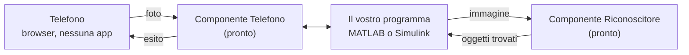

# Kit Telefono + MATLAB + riconoscimento di oggetti

Il kit vi dà due componenti pronti: il **collegamento tra telefono e PC** e il **riconoscimento di oggetti** con una rete YOLOE. Tutto il resto, in MATLAB e in Simulink, lo costruite voi.

## Da dove iniziare

1. **Scaricate il kit**: pulsante verde **Code → Download ZIP**, poi estraete lo zip in una vostra cartella.
2. In MATLAB aprite **`INIZIA_QUI.m`** e premete **Run**: controlla il PC.
3. Aprite **`PROVA_SIMULINK.slx`** (oppure **`PROVA_MATLAB.m`** e premete Run), inquadrate il QR code con il telefono e premete **Apri la fotocamera**.

La guida completa è qui sotto, ed è anche nel file [`GUIDA.pdf`](GUIDA.pdf).

## Cosa c'è nel kit

| Nella cartella del kit | Cos'è | Cosa ci fate |
| --- | --- | --- |
| `README.md`, `GUIDA.pdf` | Questa guida | La leggete |
| `INIZIA_QUI.m` | Controlla che il PC sia pronto | Lo eseguite una volta |
| `PROVA_MATLAB.m` | Esempio completo in MATLAB | Lo provate, poi lo copiate in `il_mio_progetto` |
| `PROVA_SIMULINK.slx` | Esempio completo in Simulink, con i tre blocchi già collegati | Lo provate, poi lo copiate in `il_mio_progetto` |
| `blocchi_telefono.slx` | La libreria dei tre blocchi Simulink | Trascinate i blocchi nei vostri modelli |
| `il_mio_progetto/` | **La vostra cartella** | Salvate qui tutti i vostri file |
| `modelli/` | Le reti YOLOE: `oggetti`, `frutta`, `bottiglie` | Scegliete quale usare |
| `componenti/` | Il "motore": collegamento con il telefono, Riconoscitore, funzioni dei blocchi | **Non si modifica** |

## Passo 0 – Preparare il PC (10 minuti)

1. Estraete il kit in una vostra cartella.
2. In MATLAB aprite `INIZIA_QUI.m` e premete **Run**.
3. Se compare **TUTTO PRONTO** passate al Passo 1. Altrimenti risolvete le righe **[!!]** con questa tabella.

| Messaggio [!!] | Cosa fare |
| --- | --- |
| MATLAB troppo vecchio | Installate R2023b o più recente |
| Manca Simulink, Image Processing Toolbox o Deep Learning Toolbox | **Home → Add-Ons → Get Add-Ons**, cercate il nome e installatelo |
| Il riconoscimento non parte | Controllate che la cartella `modelli` contenga oggetti, frutta e bottiglie |
| Il PC non è collegato a nessuna rete | Collegate il PC al Wi-Fi |
| Java non trovato | Installate il pacchetto gratuito [MATLAB Support for OpenJDK](https://www.mathworks.com/matlabcentral/fileexchange/180823-matlab-support-for-openjdk) (pulsante **Download**, poi doppio clic sul file scaricato) e riavviate MATLAB. Succede soprattutto sui Mac con MATLAB recente |
| Il vostro MATLAB è più vecchio di quello che ha preparato i modelli (per esempio R2025b) | Installate anche **Deep Learning Toolbox Converter for ONNX Model Format** (Home → Add-Ons, gratuito). La prima volta ogni modello viene preparato per il vostro PC in circa 20 secondi, poi parte subito |

**Niente Python, niente installazioni.** La rete YOLOE gira dentro MATLAB con Deep Learning Toolbox, che fa parte della licenza della scuola. I modelli li prepara il docente e sono già nel kit.

## Passo 1 – Collegare il telefono (5 minuti)

Il telefono non installa niente: usa il browser (Safari su iPhone, Chrome su Android).

1. In MATLAB aprite `PROVA_MATLAB.m` e premete **Run**. Si apre una finestra con un **QR code**.
2. Collegate il telefono alla **stessa rete Wi-Fi** del PC (la cosa più semplice: il PC collegato all'hotspot del telefono).
3. Inquadrate il QR code con la fotocamera del telefono e aprite il link.
4. Il telefono avvisa che la connessione non è privata: è normale, il certificato lo crea il vostro PC.
   - iPhone: **Mostra dettagli → visita il sito web**.
   - Android: **Avanzate → Procedi**.
5. Se il PC chiede di consentire a MATLAB le connessioni in entrata, rispondete **Consenti**. Su Windows spuntate anche "reti pubbliche".
6. Sul telefono premete **Apri la fotocamera** e inquadrate qualcosa.

**Funziona se** sul telefono compaiono il nome del PC, la scritta **MATLAB sta analizzando** e "Vedo N oggetti" con i riquadri sugli oggetti. Per fermare chiudete la figura "Prova MATLAB": il telefono resta collegato. Un PC accetta un solo telefono alla volta.

In basso sul telefono c'è il selettore **Video | Foto**. In **Video** le immagini partono di continuo, circa 10 al secondo, e il pulsante rosso mette in pausa. In **Foto** il pulsante bianco scatta una foto: resta ferma sullo schermo con i riquadri finché non premete la freccia. In alto il telefono mostra cosa sta cercando MATLAB, per esempio "oggetti · bottle, cup · max 5".

## Il componente Telefono

Collega il telefono al PC. Lo usate con quattro comandi:

| Comando | Cosa fa |
| --- | --- |
| `tel = Telefono();` | Avvia il collegamento e mostra la finestra con il QR code |
| `[img, info] = tel.snapshot("Nuovo", true);` | Restituisce l'ultima foto (RGB `uint8`); con `"Nuovo", true` aspetta una foto mai letta. `info` ha `numero`, `nuovo`, `fps`, `collegato` |
| `tel.inviaRisultato(r);` | Mostra il risultato `r` sullo schermo del telefono |
| `tel.chiudi();` | Chiude il collegamento (`tel.mostra()` riapre la finestra del QR) |

Il risultato `r` è una struct con questi campi, tutti facoltativi:

| Campo | Esempio | Sul telefono |
| --- | --- | --- |
| `titolo` | `"Vedo 2 mele"` | La scritta grande |
| `colore` | `"verde"`, `"giallo"`, `"rosso"`, `"grigio"`, `"blu"` o `"#RRGGBB"` | Il colore del riquadro |
| `dettaglio` | `"Rischio basso"` | La riga sotto il titolo |
| `voci` | `struct('nome', {"2 mele","1 pera"}, 'ok', {[],[]})` | Le etichette; con `ok` vero o falso compaiono ✓ o ✗ |
| `box` | `struct('x',0.4,'y',0.1,'w',0.2,'h',0.15,'etichetta',"mela 82%",'colore',"giallo")` | I riquadri sull'immagine |

Le coordinate dei `box` sono **frazioni della foto**, tra 0 e 1.

## Il componente Riconoscitore

Trova gli oggetti in una foto con una rete **YOLOE** (Ultralytics) che gira dentro MATLAB. Ogni modello conosce un elenco di etichette: **voi scegliete il modello** e, se volete, **solo alcune delle sue etichette**.

| Comando | Cosa fa |
| --- | --- |
| `r = Riconoscitore("oggetti");` | 80 oggetti comuni: persone, bottiglie, tazze, telefoni, sedie, … |
| `r = Riconoscitore("frutta");` | Un altro modello della cartella `modelli` |
| `r = Riconoscitore("frutta", Etichette=["apple","pear"]);` | Solo alcune etichette del modello |
| `Riconoscitore.modelli()` | Elenca i modelli e le loro etichette |
| `r.Soglia = 0.3;` | Scarta gli oggetti con punteggio sotto 0,3 |
| `r.MaxOggetti = 5;` | Tiene al massimo i 5 oggetti più sicuri |
| `ogg = r.rileva(img);` | Gli oggetti trovati nella foto |
| `r.trova("bottle")` | Cerca tra le etichette del modello |
| `r.mostra(img, ogg)` | Disegna la foto con i riquadri |
| `ris = r.perTelefono(ogg, img);` | Prepara un risultato standard ("Vedo 3 oggetti") per `tel.inviaRisultato` |

`ogg` è una tabella con una riga per oggetto: `ogg.Etichetta` (il nome), `ogg.Punteggio` (da 0 a 1), `ogg.Box` (`[x y larghezza altezza]` in pixel) e `ogg.Classe` (il numero dell'etichetta).

**I modelli.** Nel kit ci sono `oggetti` (80 oggetti comuni), `frutta` (apple, pear, orange, banana, lemon) e `bottiglie` (coca-cola bottle, water bottle, aluminum can, glass). Ogni modello è una cartella dentro `modelli`: non modificatela.

**Volete riconoscere altro?** Mandate al docente l'elenco delle etichette in inglese, con nomi semplici e concreti come in una didascalia: `apple`, `water bottle`, `safety helmet`. Il docente crea il modello con Ultralytics e ve lo dà come cartella, da copiare in `modelli`.

## I blocchi Simulink

La libreria `blocchi_telefono.slx` contiene tre blocchi: apritela e trascinate i blocchi nel vostro modello. Facendo doppio clic su un blocco si aprono le sue impostazioni. Per vederli già collegati aprite **`PROVA_SIMULINK.slx`**.

| Blocco | Ingressi | Uscite | Impostazioni |
| --- | --- | --- | --- |
| **Fotocamera telefono** | – | `Immagine` (altezza × larghezza × 3), `Nuova`, `Collegato` | Dimensioni dell'immagine (640 × 480), ogni quanto leggere una foto (0,1 s = 10 al secondo), avvio automatico |
| **Riconoscitore** | `Immagine` | `Oggetti` (una riga per oggetto: x, y, larghezza, altezza, punteggio, classe), `Numero` | **Modello** e **cosa riconoscere** (anche dall'elenco), soglia, numero massimo di oggetti |
| **Schermo telefono** | `Oggetti`, `Livello` | – | I messaggi per ogni livello, per esempio `Tutto ok\|Attenzione\|Pericolo`, e i loro colori |

Lo Schermo disegna sempre i riquadri degli oggetti. Con `Livello` = 0 mostra solo cosa vede; con 1, 2, 3... il titolo diventa il messaggio corrispondente, nel suo colore.

**Un solo clic per partire.** Basta aprire il modello, anche con doppio clic sul file: compaiono subito la finestra del QR code e il server. Appena il telefono comincia a inviare le foto, la simulazione parte da sola, senza premere Run. Se la fermate con Stop, riparte quando il telefono si scollega e si ricollega, oppure con Run. Per spegnere l'avvio automatico togliete la spunta nel blocco Fotocamera telefono.

**Scegliere cosa riconoscere.** Doppio clic sul Riconoscitore e poi il pulsante **Scegli modello e oggetti dall'elenco…**: si apre una finestra con il menu dei modelli e l'elenco delle cose che il modello sa riconoscere, con le caselle da spuntare e una ricerca. Nessuna spunta vuol dire tutto. Modello e oggetti si possono cambiare anche mentre la simulazione gira; il numero massimo di oggetti solo a simulazione ferma.

**Il vostro primo modello (5 minuti):**

1. Eseguite `INIZIA_QUI.m`, che aggiunge il kit ai percorsi di MATLAB. Poi create un nuovo modello Simulink vuoto e salvatelo in `il_mio_progetto`.
2. Aprite `blocchi_telefono.slx` e trascinate i tre blocchi nel modello.
3. Collegate `Immagine` → Riconoscitore e `Oggetti` → Schermo.
4. Aggiungete un blocco **Constant** con valore 0 e collegatelo a `Livello`.
5. In **Stop time** scrivete `inf` e salvate. Da questo momento basta aprire il modello: compare il QR code e, appena il telefono invia le foto, la simulazione parte da sola.
6. Doppio clic sul Riconoscitore, poi **Scegli modello e oggetti dall'elenco…**: scegliete il modello (per esempio `frutta`), spuntate per esempio apple e banana e premete OK.

Al posto della Constant mettete la vostra logica: contare gli oggetti, confrontarli con una soglia, calcolare un livello di rischio.

## Il vostro progetto

**Fase 1 – Riconoscere oggetti (adesso).** Scegliete voi cosa riconoscere: frutta, bottiglie, oggetti della scrivania. Il telefono deve mostrare cosa vede, con i riquadri e un elenco. Fatelo prima in MATLAB partendo da `PROVA_MATLAB.m`, poi in Simulink partendo da `PROVA_SIMULINK.slx`. Salvate le vostre copie in `il_mio_progetto`.

- [ ] Il telefono mostra gli oggetti che avete scelto
- [ ] Avete misurato quante volte li riconosce correttamente, con almeno 20 foto
- [ ] In Simulink: Fotocamera → Riconoscitore → la vostra logica → Schermo

**Fasi successive (prossime lezioni).** Aggiungerete una valutazione del rischio. Poi insegnerete alla rete a riconoscere i DPI (casco, giubbotto, guanti, occhiali) e modificherete lo schema Simulink di conseguenza. La nuova rete si inserisce nel kit come un qualsiasi altro modello della cartella `modelli`.

## Problemi frequenti

| Problema | Soluzione |
| --- | --- |
| Il telefono non apre la pagina | Telefono e PC devono essere sulla stessa rete. Le reti dell'università spesso isolano i dispositivi: attivate l'**hotspot del telefono**, collegate il PC all'hotspot e premete **Aggiorna rete** nella finestra del QR |
| Il telefono dice "PC già occupato" | Un altro telefono è collegato al vostro PC: nella finestra del QR premete **Nuovo codice** |
| Il telefono non accetta il certificato | Nella finestra del QR premete **Link solo foto**: funziona senza certificato, con foto singole |
| Il telefono dice "MATLAB non sta leggendo" | Il collegamento c'è, ma non gira nessun programma: eseguite il vostro script o aprite/avviate il modello Simulink |
| Ho chiuso la finestra del QR | Il collegamento resta attivo: `tel.mostra()` la riapre |
| Un oggetto non viene mai trovato | Abbassate la soglia, oppure controllate con `r.trova("...")` che l'etichetta sia nel modello |
| "Il modello non conosce: …" | Scegliete tra le etichette elencate nel messaggio, oppure chiedete un modello nuovo al docente |
| "Java non trovato" oppure "no runtime environment for Java" | Installate [MATLAB Support for OpenJDK](https://www.mathworks.com/matlabcentral/fileexchange/180823-matlab-support-for-openjdk) e riavviate MATLAB |
| "Il vostro MATLAB è più vecchio…" | Installate **Deep Learning Toolbox Converter for ONNX Model Format** da Home → Add-Ons e riprovate |
| "Serve Deep Learning Toolbox" | **Home → Add-Ons → Get Add-Ons**, cercate Deep Learning Toolbox e installatelo, poi rieseguite `INIZIA_QUI` |
